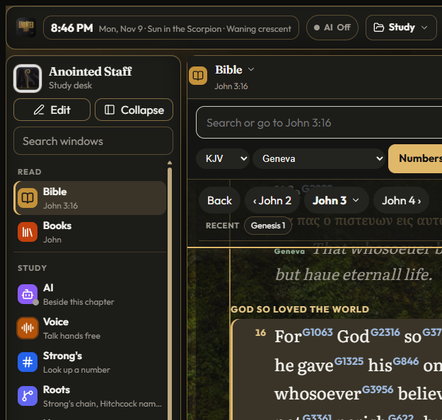
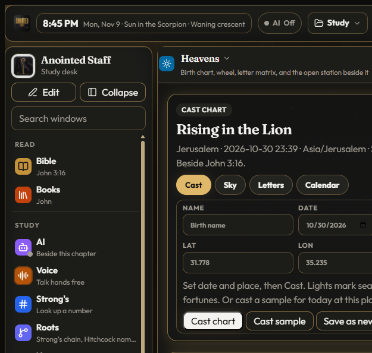
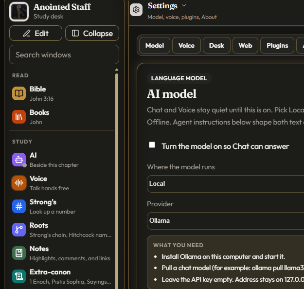
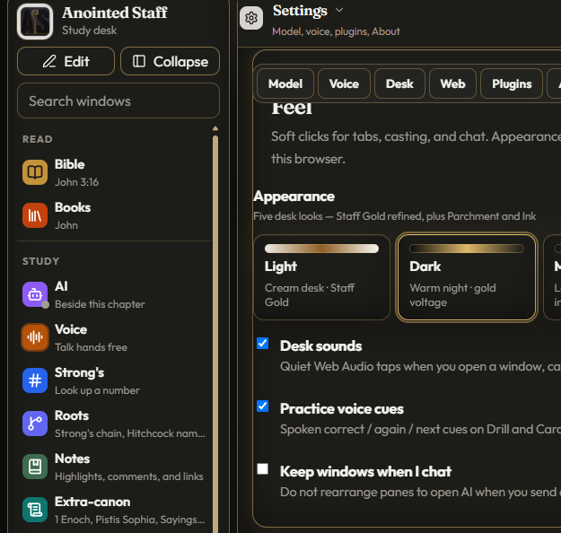

# Anointed Staff

<p align="center">
  
</p>

<p align="center"><b>A study desk you keep — Scripture beside language, Extra-canon, and the sky.</b></p>

<p align="center">
  <a href="https://anointedstaff.pages.dev"><b>🌐 anointedstaff.pages.dev</b></a>
  &nbsp;·&nbsp;
  <a href="https://github.com/quantumfiduciary/anointedstaff/releases"><b>Download for Windows</b></a>
</p>

<p align="center">
  
  
  
  
  
  
  
</p>

---

## What is Anointed Staff?

**Anointed Staff** is a local-first Scripture study desk for Windows. Read the Word beside notes, Strong’s, Roots, Extra-canon, Heavens clocks, and offline Practice — without shipping your notes or keys to a cloud Bible.

Public-domain English witnesses only. No NIV / ESV / NET. Clocks beside Scripture, not fortunes. Hermetic shelves are historical study, not ritual.

---

## Why Anointed Staff?

Most Bible apps keep you online, track reading habits, and sit behind accounts. Anointed Staff is the opposite posture: **a desk you keep on the machine**. Notes, charts, and API keys stay local. The marketing site educates; the study runtime installs from a GitHub Release.

Campaign line: *A study desk you keep, not a cloud Bible that keeps you.*

---

## The desk

<p align="center">
  
</p>

<p align="center"><em>Bible rail — Scripture beside study tools on a local desk.</em></p>

### Highlights

- **Scripture desk** — Reader, notes, wiki, Strong’s, Roots, Gematria, and optional AI chat on a local machine.
- **Extra-canon shelf** — Public-domain library beside the sixty-six, with clear credits on each work.
- **Heavens** — Cast and Witness as clocks beside Scripture (Isaiah 47 stance — not fortune-telling).
- **Practice** — Offline Temple walk, Hebrew Hear clips, Quiet music, and five desk looks (Light · Dark · Mystic · Parchment · Ink).
- **Local-first privacy** — Session-only keys by default; notes and charts stay on device.

<p align="center">
  
  &nbsp;
  
</p>

<p align="center">
  
  &nbsp;
  
</p>

---

## Get started

1. **Download** the Windows installer from [Releases](https://github.com/quantumfiduciary/anointedstaff/releases) (`Anointed Staff_0.1.0_x64-setup.exe`).
2. Or **run from source**:

```bash
npm install
npm run dev
```

3. Read the product story and blogs at [anointedstaff.pages.dev](https://anointedstaff.pages.dev).

---

## License

**Application source:** [Apache License 2.0](LICENSE).

**Scripture, Extra-canon, cross-refs, Practice audio, and brand art** are not Apache-washed — see [NOTICE](NOTICE) for the content split (PD / CC BY / River bake terms / brand reserved).

Credits also live in-app: **Settings → About → Licenses & acknowledgments**.

---

## Developers

Build scripts, ingest rules, packaging notes, and security detail live in **[docs/developer.md](docs/developer.md)**. Deploy checklist: **[docs/deploy-github-pages.md](docs/deploy-github-pages.md)**. Visual system: **[DESIGN.md](DESIGN.md)**.
