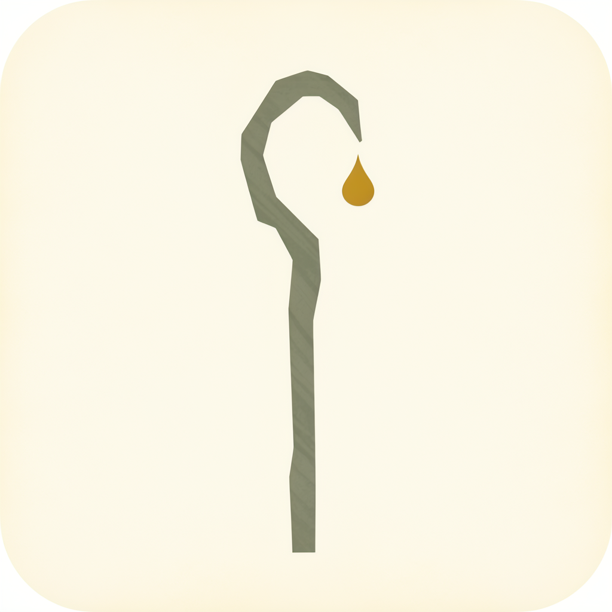

# Anointed Staff

<p align="center">
  
</p>

<p align="center"><b>A lamp-lit desk for the Word you keep — Scripture beside Strong’s, Extra-canon, Heavens, Notes, and quiet Practice.</b></p>

<p align="center">
  <a href="https://anointedstaff.pages.dev"><b>🌐 anointedstaff.pages.dev</b></a>
  &nbsp;·&nbsp;
  <a href="https://github.com/quantumfiduciary/anointedstaff/releases"><b>Download for Windows</b></a>
</p>

<p align="center">
  
  
  
  
  
  
  
</p>

---

## What is Anointed Staff?

**Anointed Staff** is a local-first Scripture study desk for Windows. The chapter stays the center of the room. Strong’s, Roots, Extra-canon, Heavens clocks, Notes, Gematria, Practice, and optional AI open beside it — without shipping your notes or keys to a cloud Bible.

Public-domain English witnesses only. No NIV / ESV / NET. Clocks beside Scripture, not fortunes. Hermetic shelves are historical study, not ritual.

Campaign line: *A study desk you keep, not a cloud Bible that keeps you.*

---

<p align="center">
  
</p>

<p align="center"><em>Heavens Cast beside Books — clocks and glory, not fortunes.</em></p>

---

## Features

### Read
- **Bible** — Public-domain witnesses; chapter stays the altar of the desk
- **Books** — Canon navigation and search while the verse rail stays open
- **Compare · Listen** — Second PD witnesses and chapter read-aloud

### Study
- **Strong’s** — Number lookup, This verse, Paleo notes, Hear, Ask about this word
- **Roots** — Strong’s chains, Hitchcock names, English trees
- **Notes** — Highlights, Write, Wiki, Kanban, Cards, Table, Board (notes stay on device)
- **Extra-canon** — PD shelf beside the sixty-six (Enoch, Sophia, Gospels.net, Fathers, Hermetic…)
- **AI** — Optional local/cloud model beside the chapter; session-only keys by default
- **Voice** — Hands-free study window

### Tools
- **Gematria** — Letter study, mothers/doubles/simples, count, Hear, drills
- **Heavens** — Cast, Witness, Decans, Circle, Camp, Job 38, Psalm 19 (clocks-not-fortunes)
- **Practice** — Temple walk, Drill, Cards, Meditate, Quiet music

### Desk
- **Five appearances** — Light · Dark · Mystic · Parchment · Ink
- **Local-first** — Leave-device confirms; notes and charts stay on the machine

---

## Gallery

<p align="center">
  
  &nbsp;
  
</p>

<p align="center">
  
  &nbsp;
  
</p>

<p align="center">
  
  &nbsp;
  
</p>

### Desk notes

- [Extra-canon as a public-domain shelf](https://anointedstaff.pages.dev/blog/extra-canon-public-domain-shelf)
- [Heavens: clocks, not fortunes](https://anointedstaff.pages.dev/blog/heavens-clocks-not-fortunes)
- [Offline Practice and a quiet desk](https://anointedstaff.pages.dev/blog/offline-practice-quiet-desk)

---

## Get started

1. **Download** the Windows installer from [Releases](https://github.com/quantumfiduciary/anointedstaff/releases) (`Anointed Staff_0.1.0_x64-setup.exe`).
2. Or **run from source**:

```bash
npm install
npm run dev
```

3. Read the lore and blogs at [anointedstaff.pages.dev](https://anointedstaff.pages.dev).

---

## License

**Application source:** [Apache License 2.0](LICENSE).

**Scripture, Extra-canon, cross-refs, Practice audio, and brand art** are not Apache-washed — see [NOTICE](NOTICE) for the content split (PD / CC BY / River bake terms / brand reserved).

Credits also live in-app: **Settings → About → Licenses & acknowledgments**.

---

## Developers

Build scripts, ingest rules, packaging notes, and security detail live in **[docs/developer.md](docs/developer.md)**. Marketing voice: **[docs/marketing.md](docs/marketing.md)**. Deploy checklist: **[docs/deploy-github-pages.md](docs/deploy-github-pages.md)**. Visual system: **[DESIGN.md](DESIGN.md)**. Landing CRO notes: **[LANDING-CRO.md](LANDING-CRO.md)**.
